<picture>
  <source media="(prefers-color-scheme: dark)" srcset="./assets/header-dark.svg">
  <source media="(prefers-color-scheme: light)" srcset="./assets/header-light.svg">
  
</picture>

<p align="center">
  <a href="https://satamihir.github.io"><picture><source media="(prefers-color-scheme: dark)" srcset="./assets/btn-portfolio-dark.svg"><source media="(prefers-color-scheme: light)" srcset="./assets/btn-portfolio-light.svg"></picture></a>
  <a href="https://www.linkedin.com/in/satamihir/"><picture><source media="(prefers-color-scheme: dark)" srcset="./assets/btn-linkedin-dark.svg"><source media="(prefers-color-scheme: light)" srcset="./assets/btn-linkedin-light.svg"></picture></a>
  <picture><source media="(prefers-color-scheme: dark)" srcset="./assets/btn-status-dark.svg"><source media="(prefers-color-scheme: light)" srcset="./assets/btn-status-light.svg"></picture>
</p>

```console
$ whoami
mihir sata · full-stack developer · kitchener, ontario · five years in

$ cat principles.txt
▸ full-stack, in both directions
  i don't hand off at the API boundary. i follow the bug.
▸ payments-grade carefulness
  an edge case isn't a ticket. it's someone's 4pm friday.
▸ llms in production, not demos
  if it doesn't ship, it doesn't count.
```

---

### `01 / trajectory`
<sub>where the five years went</sub>

<pre>
$ git log --graph --oneline career

* 2026 ─ now    <b>(HEAD -&gt; open-to-work)</b>  your team, maybe?
│
* 2024 ─ 2026   <b>LBMX</b> · software developer · london, on
│               ├─ 9 payment workflows, angular front to .net back
│               ├─ gemini over 1,000+ documents in a single pass
│               └─ sql server sleuthing on live production issues
│
* 2022 ─ 2023   <b>CONESTOGA COLLEGE</b> · pg cert, web development · gpa 3.5
│
* 2021          <b>STACKBY.COM</b> · frontend engineer
│               ├─ 8+ modules in react, redux, typescript
│               ├─ page loads 25–30% faster
│               └─ shipped a private npm ui library, used platform-wide
│
* 2020 ─ 2021   <b>NAROLA INFOTECH</b> · software engineer
│               ├─ traffic simulator (vue + node)
│               ├─ booking system + slot-conflict detection (django)
│               └─ payment gateway modules (react + tailwind)
│
* 2014 ─ 2018   (root)  <b>PARUL UNIVERSITY</b> · b.e. computer science · gpa 3.4
</pre>

<details>
<summary><code>$ git show --stat</code> &nbsp;·&nbsp; the full changelog</summary>
<br>

**LBMX** · Intermediate Software Developer · `Feb 2024 — Jun 2026` · London, ON
- Shipped full-stack features across **9 payment workflows** on an enterprise B2B payment platform:
  `Make Payments` `Payment Batches` `Received Invoices` `Invoice Reconciliation` `Statement of Account` `Pay by Statement` `Mark as Paid` `Allocate Credit` `Print Payment Options`
- Built the **Angular + TypeScript** frontend for those flows: complex UI state, form validation, and dense data tables for invoice, supplier and transaction views.
- Extended **C#/.NET** service-layer logic across **5+ modules**: request handlers, validation rules and REST integrations powering core payment operations.
- Integrated **Gemini LLM APIs** into TradeSync for AI-assisted bulk document processing, **1,000+ documents per run**.
- Wrote and tuned **SQL Server** queries to trace data discrepancies and fix live production issues mid-feature.

**Stackby.com** · Software Engineer, Frontend · `May 2021 — Dec 2021` · Gujarat, India
- Built and extended **8+ platform modules** in React, Redux and TypeScript:
  `Dashboard` `Grid View` `Kanban Board` `Calendar View` `Authentication` `Search & Filters` `Notifications` `User Management`
- Cut page-load time by **25–30%** with reusable components, render optimisation, memoisation and lazy loading.
- Published a **private npm library** of reusable UI components (forms, modals, data tables, filters, validation) adopted across the whole platform.

**Narola Infotech Solutions** · Software Engineer · `Jun 2020 — May 2021` · Gujarat, India
- **Traffic Simulator:** full-stack modules in Vue.js and Node.js, with REST APIs for simulation scenarios, vehicle movement, routes and signal timing.
- **Booking Management System:** Python + Django + MySQL backend. Designed the schema and REST APIs for scheduling, including **time-slot conflict detection** across overlapping bookings.
- **Payment gateway:** contributed React, TypeScript and TailwindCSS modules and CRUD APIs alongside senior developers.

**Education**
- **Post Graduate Certificate, Web Development** · Conestoga College, Waterloo, ON · `2022 — 2023` · GPA 3.5 / 4.0
- **B.E. Computer Science Engineering** · Gujarat Technological University (Parul University) · `2014 — 2018` · GPA 3.4 / 4.0

</details>

---

### `02 / selected work`
<sub>three things worth showing. each one is a problem, a move, and a result.</sub>

<table>
<tr><td>

#### `i.` &nbsp;Enterprise B2B payment platform
<sub><b>LBMX</b> · Angular · C#/.NET · SQL Server</sub>

> **problem** &nbsp;Suppliers and buyers reconciling invoices across nine payment paths, each with its own rules.<br>
> **move** &nbsp;&nbsp;&nbsp;&nbsp;End-to-end features across all nine workflows and the invoice, supplier and banking modules, from frontend state and validation through to .NET service logic.<br>
> **result** &nbsp;&nbsp;Core payment operations **shipped and running in production**.

</td></tr>
<tr><td>

#### `ii.` &nbsp;AI-assisted bulk document processing
<sub><b>LBMX</b> · Gemini API · TradeSync</sub>

> **problem** &nbsp;Users opening documents one at a time to pull out the same handful of fields.<br>
> **move** &nbsp;&nbsp;&nbsp;&nbsp;Integrated Gemini so a user can upload a batch and run a custom prompt across the whole set.<br>
> **result** &nbsp;&nbsp;**1,000+ documents** analysed in one pass instead of one by one.

</td></tr>
<tr><td>

#### `iii.` &nbsp;Zorro Copilot &nbsp;
<sub><b>personal project</b> · Python · FastAPI · PydanticAI · React · pgvector · OpenAI</sub>

> **problem** &nbsp;Analysts digging through 10-Ks and 10-Qs by hand to answer questions they need a citable source for.<br>
> **move** &nbsp;&nbsp;&nbsp;&nbsp;An internal AI chatbot with a FastAPI backend and a Vite + React + TypeScript frontend. Ask in plain English, get **sourced, citable answers** back.<br>
> **result** &nbsp;&nbsp;Running against a real document corpus right now.

</td></tr>
</table>

<details>
<summary><b>also built</b> · five more from the archive</summary>
<br>

**Stackby component library** &nbsp;<sub>`React` `Redux` `TypeScript` `npm`</sub><br>
Eight product modules were each re-implementing the same forms, modals, tables and filters. I extracted the shared patterns into a versioned private npm library with consistent validation and state contracts, then moved Calendar View onto Grid View's data flow so the two stopped drifting apart. The result was one UI vocabulary across the product and **25–30% faster page loads**.

**Traffic simulator** &nbsp;<sub>`Vue.js` `Node.js` `Vuetify`</sub><br>
A full-stack simulation of vehicle movement, routing and signal timing. I designed the REST APIs for scenarios and live simulation state, and built the parameter-input, traffic-flow monitoring and chart-analytics interfaces on top. I chose Vuetify over Bootstrap and tuned against Lighthouse profiles, so the UI stays responsive while the simulation runs.

**Job Board Platform** &nbsp;<sub>`Java` `SQL` `AWS Amplify`</sub><br>
A hiring marketplace that puts job listings next to company reviews and salary data, so candidates can judge an offer before they apply. The relational schema connects companies, roles, reviews and compensation, with Java services behind it and AWS Amplify for hosting.

**FoodX** &nbsp;<sub>`React` `Redux` `MySQL` `AWS`</sub><br>
A recipe platform where users build and customise their own recipes, starting from star-rated recipes and chefs. Ratings, chef profiles and user-curated recipes are modelled in MySQL, and a React + Redux client handles the customisation flow. Deployed on AWS.

**PayFX** &nbsp;<sub>`React` `Redux` `Python` `Flask`</sub><br>
A market-research platform for crypto and equities. Each asset gets a detailed view of its data and analysis to help users decide what to buy. A Python/Flask service handles market data, and a React + Redux dashboard presents it.

</details>

---

### `03 / toolkit`
<sub>what i'd want to be hired for. no percentage bars.</sub>

<p>


</p>

<details>
<summary><code>$ ls --all ~/toolkit</code> &nbsp;·&nbsp; the full spectrum, grouped by where it sits in the stack</summary>
<br>

<table>
<tr>
<td valign="top" width="150"><b>frontend</b><br><sub>the layer users judge you by</sub></td>
<td>


</td>
</tr>
<tr>
<td valign="top" width="150"><b>backend</b><br><sub>where the rules live</sub></td>
<td>


</td>
</tr>
<tr>
<td valign="top" width="150"><b>data</b><br><sub>where the truth lives</sub></td>
<td>


</td>
</tr>
<tr>
<td valign="top" width="150"><b>ai & agents</b><br><sub>shipped, not demoed</sub></td>
<td>


</td>
</tr>
<tr>
<td valign="top" width="150"><b>cloud & infra</b><br><sub>where it runs</sub></td>
<td>


</td>
</tr>
<tr>
<td valign="top" width="150"><b>workflow</b><br><sub>how it gets there</sub></td>
<td>


</td>
</tr>
</table>

</details>

---

### `04 / reach me`
<sub>take the glasses off. let's talk.</sub>

| **connect** | [linkedin.com/in/satamihir](https://www.linkedin.com/in/satamihir/) | the full résumé, always current |
|---|---|---|
| **see it properly** | [satamihir.github.io](https://satamihir.github.io) | the whole thing, seen through sunglasses |
| **based in** | Kitchener, Ontario | open to intermediate & senior full-stack roles, on-site or remote |

<br>

<p align="center">
  <sub><code>&gt; keep looking</code></sub><br>
  <sub>made with love and far too many late nights.</sub>
</p>
